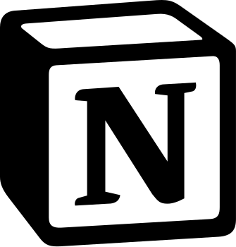

<p align="center">
  
</p>

<h1 align="center">Notion AI Tools</h1>

<p align="center">文字对话 · 工具调用 · 结果回传</p>

把自己的 Notion AI 账号接入 Magpie，供 Claude Code、Codex、OpenCode 等客户端调用文字模型及客户端工具。

包名为 `magpie-notion-tools`，使用经典黑白 Notion 图标。Notion Opus 5.5、Sonnet 5.5 已通过真实网关的读写工具测试和 Claude Code 的自动读文件测试。

## 安装

需要 Node.js 20 或以上，并已安装 Magpie。下载[插件安装包](https://github.com/renyuanhui1/magpie-notion-tools/releases/latest/download/magpie-notion-tools.zip)，解压到一个固定目录，在该目录打开 PowerShell，执行：

```powershell
npm ci --ignore-scripts --no-audit --no-fund
$magpie = (Get-Command magpie -ErrorAction Stop).Source
$plugin = (Get-Location).Path
& $magpie plugin add $plugin
& $magpie plugin use $plugin notion
```

本地目录是运行源文件位置，需要保留目录及其 `node_modules`。

`Get-Command magpie` 找不到命令时，先把 Magpie 的安装目录加入当前终端的 PATH，或将 `$magpie` 设为自己电脑上 `magpie.exe` 的实际位置。

Magpie 登录页会显示插件的安装来源。本地安装时显示当前电脑的插件目录，这不是插件内置的固定路径。

Provider ID 为 `notion`，因此 Magpie 可以沿用该来源保存的登录。

## 登录

### 浏览器登录

插件安装包已包含扩展，也可以[单独下载扩展](https://github.com/renyuanhui1/magpie-notion-tools/releases/latest/download/notion-magpie-extension.zip)并解压。

首次使用时，在平时登录 Notion 的浏览器中打开扩展管理页：Chrome 使用 `chrome://extensions`，Edge 使用 `edge://extensions`。开启「开发者模式」，点击「加载已解压的扩展程序」，选择解压后的 `extension` 文件夹。扩展名为「Notion → Magpie」，无需创建浏览器配置或退出已有账号。加载后请保留这个文件夹。

在 Magpie 的 Notion 登录入口选择「浏览器登录」，系统默认浏览器会打开本机连接页。在同一个浏览器配置中登录 Notion，然后回到连接页点击「连接当前 Notion 账号」。页面显示邮箱和工作区后，选定工作区并确认连接。同一个邮箱再次连接时，会更新 Magpie 中该账号的工作区。

扩展仅在点击连接后读取 Notion 的 `token_v2`，交给本机插件核验；它不读取 Google 登录信息，不读取浏览历史，也不将凭据写入浏览器扩展存储。邮箱、用户标识、工作区和会话最终由 Magpie 保存。点击取消会结束连接，一分钟未完成会超时；关闭网页后，未确认的连接也会在超时后清理。手动「粘贴 token_v2」入口仍可使用。

若页面提示未检测到扩展，确认扩展已安装在当前浏览器配置中，再刷新连接页。若提示未登录，先在同一个浏览器配置中正常登录 Notion，再返回连接页；Google 登录可在日常浏览器中完成。连接页过期后，请从 Magpie 重新发起。

点击浏览器工具栏的扩展图标会显示连接步骤。账号连接需要先从 Magpie 发起；扩展图标不会直接读取或导入当前账号。

刷新 Magpie 模型列表，使用实际显示的 `notion/模型ID`。模型及额度由账号和工作区决定，插件不会赋予付费权益。

### 手动粘贴 token_v2

这种方式不需要安装浏览器扩展：

1. 在 Chrome 或 Edge 中打开 [Notion](https://app.notion.com)，登录自己的账号并进入要使用的工作区。
2. 按 `F12` 打开开发者工具，选择「应用 / Application」。窗口较窄时，这个标签可能在顶部的 `»` 菜单里。
3. 在左侧「存储 / Storage」中，展开「Cookie / Cookies」前的小三角，再点击当前的 Notion 站点，例如 `https://app.notion.com`。只选中 Cookies 标题不会显示具体条目。
4. 在 Cookie 列表的筛选框输入 `token_v2`，选中名称完全相同的那一行，复制「值 / Value」列中的完整内容。请勿复制名称、整张表格或其他 Cookie。
5. 回到 Magpie，打开 Notion 来源的「添加账号 / 添加其他账号」，选择「粘贴 token_v2」，粘贴刚才的值并完成登录。
6. 刷新模型列表，再通过 Magpie 网关使用该来源的模型。

值可能以 `v03%3A` 或 `v03:` 开头，保留原样即可，不需要手动解码。如果没有这一行，先确认当前网页已经进入 Notion 工作区，再刷新开发者工具中的 Cookie 列表。

`token_v2` 是 Notion 网页的登录会话凭据，不是 Notion 集成 API Key，也不是 Magpie 网关 Key。只将它填入自己电脑上的 Magpie，不要发到 GitHub Issue、聊天或截图中。会话失效或退出登录后，可能需要重新获取。

## 使用

通过现有 Magpie 网关地址和网关 Key 调用模型。客户端带上标准函数工具定义，模型请求调用后，客户端负责确认权限、执行工具并发送结果。插件自身只传输和校验数据。

支持：

- 文字对话，以及现代 Chat Completions 函数工具。
- 多轮 `tool_calls` 与 `tool_call_id` 结果关联。
- `tool_choice` 的 auto、none、required 和指定函数，以及 `parallel_tool_calls: false`。
- Draft 7、Draft 2020-12 JSON Schema 参数校验。
- 一轮最多返回 8 个调用；工具目录最多 128 个工具。

带工具的请求采用提示词约定的 JSON 格式，完成后才返回标准工具事件。SSE 格式可用，但工具回答会完整缓存，不是逐字输出参数。工具请求每轮新建 Notion 线程并发送完整历史，以保持调用和结果一致；普通文字对话可以复用线程。

图片、音频、旧式 functions、自定义非 JSON 函数工具不受支持。模型未遵守结构或参数要求时返回明确错误，不会猜测或执行内容。Magpie 的其他协议转换仍由 Magpie 负责，具体客户端兼容性以实测为准。

这是 Notion 私有网页接口的非官方适配，接口变化可能导致失效。工具生成并非原生 function calling。

额度显示区分标准、精选和 Notion 积分，由账号接口提供。当前网页适配链路没有可靠的 token 统计，客户端显示 0 不代表实际消耗为 0，也不能据此换算每积分对应的 token 数。

## 排查失败

错误会显示失败接口及 HTTP 状态。`payment_reason_unknown` 表示上游返回 402，但没有可识别的具体原因；它不等于已确认额度耗尽。请在同一工作区的 Notion 网页检查 AI 提示。模型目录可读取只证明认证和目录请求成功，不证明生成或 Claude Code 工具调用已通过验证。

## 检查

```powershell
npm test
npm run check
```

测试使用模拟上游，不消耗账号额度。`scripts/verify-live.mjs` 则使用真实网关进行一次受控工具任务，需要通过环境变量 `MAGPIE_GATEWAY_KEY` 提供网关 Key，并在参数中指定模型。

## 来源

Notion 通信、认证输入与对话解码复用 [resucdueff/magpie-notion](https://github.com/resucdueff/magpie-notion) 的 MIT 许可代码，许可保存在 `LICENSE`。工具桥接位于 `tools.mjs`。

MIT 许可适用于项目代码；Notion 名称及图标归其权利人所有，不属于本项目的 MIT 授权范围。本项目为非官方适配，与 Notion 无隶属关系。
